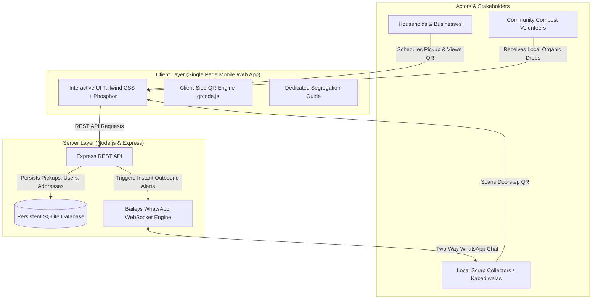

<div align="center">

# 🌿 circular. (Terra)
### *Your waste. Better placed.*

A next-generation hyperlocal circular economy platform connecting households, commercial establishments, and local scrap collectors (*kabadiwalas*) through an intelligent doorstep pickup network and a zero-install WhatsApp bot.

[](https://nodejs.org/)
[](LICENSE)
[](https://github.com/WhiskeySockets/Baileys)
[](https://tailwindcss.com/)
[](https://sqlite.org/)

<br/>

[Key Highlights](#-key-highlights) •
[System Architecture](#-system-architecture) •
[Features by Role](#-features-by-role) •
[WhatsApp Collector Network](#-zero-app-whatsapp-collector-network) •
[Getting Started](#-getting-started) •
[Security & Privacy](#-security--privacy)

</div>

---

## 🌟 Key Highlights

* **Zero-Install Collector Onboarding:** Local collectors (*kabadiwalas*) do not need to download or learn an app. They receive pickup alerts, accept orders, and complete doorsteps entirely via **WhatsApp**.
* **Scan-to-Verify Doorstep QR:** Customers display a dynamically rendered WhatsApp QR code. When the collector scans it with their phone camera, it auto-verifies the order, calculates cash payouts for recyclables, and awards Green Points.
* **Bilingual Conversational AI Bot:** Native Hinglish / Hindi & English conversational engine powered by direct Baileys WebSockets (no costly per-message business API fees).
* **Multi-Tier Waste Segregation:** Real-time segregated waste verification covering Biodegradable (Wet), Dry Recyclables, Other (Hygiene), E-Waste, and Hazardous materials.
* **Scrap Payout Calculator:** Real-time market rates for cardboard, office paper, scrap iron, copper, aluminium, and industrial plastics.
* **Gamified Green Points:** Environmental contribution tracking with seedling, plant, tree, and medal achievement tiers.

---

## 📐 System Architecture



---

## 👥 Features by Role

### 1. 🏠 Households
* **Smart Scheduling:** Pre-configure default morning, afternoon, evening, or immediate pickup slots.
* **Segregation Toggle:** Pre-select segregated waste with dynamic non-segregated penalty warnings.
* **Segregation Guide:** Full-page expandable accordion guide detailing instructions for food scraps, clean dry paper/plastics, e-waste, and sharps.
* **Green Points Wallet:** Bottom sheet tracking environmental points earned per completed pickup.
* **Floating Live Status Banner:** Home screen pill indicating active order progress, swipeable to Activity.
* **Activity Management:** Reschedule to Instant ⚡, Tomorrow Morning, Tomorrow Evening, or Cancel.

### 2. 🏢 Commercial Businesses
* **Bulk Disposal Form:** High-volume category checklist for Cartons, Records, Hard Plastics, Cloth, and Scrap Metals.
* **Scrap Sub-Categories:** Dedicated selectors for Copper, Iron, and Aluminium.
* **Scrap Rate Card:** Built-in market pricing per kg with live estimated payout calculations.
* **Interval Booking:** Set commercial recurring windows and tonnages.

### 3. 🌱 Community Volunteers (Recycler Units)
* **Unit Onboarding:** Differentiate between Volunteer Drop-off premises and Industrial Recycling factories.
* **Community Composting:** Bio & repurposing method declaration (terrace gardens, animal feed, biogas).
* **Duty Toggle:** One-tap pause / resume toggle to opt in or out of receiving neighborhood drop-offs.

---

## 📲 Zero-App WhatsApp Collector Network

The collector experience requires **no software installation**:

```text
1. Customer books pickup ➔ Bot sends instant alert to nearest collector on WhatsApp:
   "🔔 NAYA PICKUP ALERT! #REQ-4692 • 15 kg Dry Recyclables • Model Town"

2. Collector arrives at doorstep ➔ Customer taps [Show QR] on phone screen.

3. Collector points WhatsApp camera at screen ➔ Auto-opens chat with:
   "VERIFY REQ-4692 6348"

4. Collector hits Send:
   ➔ Pickup immediately marks COMPLETED in database
   ➔ Household screen instantly celebrates with "+50 Green Points!"
   ➔ Bot asks collector: "⚖️ Reply with measured weight (kg):"

5. Collector replies "14 kg":
   ➔ Payout calculated: ₹140
   ➔ WhatsApp cash receipt sent to both collector and customer!
```

---

## 🛠️ Tech Stack

| Component | Technology | Description |
| :--- | :--- | :--- |
| **Frontend** | Vanilla JavaScript (ES6+), HTML5, Tailwind CSS | Ultralight, dependency-free mobile web app running at 60 FPS |
| **Icons** | Phosphor Icons | Crisp, modern vector iconography |
| **QR Engine** | Local Client-Side `qrcode.js` | Instant 0ms offline QR generation without external APIs |
| **Backend** | Node.js, Express.js | Modular REST API with structured controllers |
| **Database** | SQLite via `sql.js` | Fast embedded relational database with file persistence |
| **Messaging** | `@whiskeysockets/baileys` | Native, headless WhatsApp WebSocket client (no browser/Puppeteer required) |
| **Auth** | WhatsApp OTP Verification | Instant OTP delivery directly to user's WhatsApp number |

---

## 🚀 Getting Started

### Prerequisites
* **Node.js** (v18.0.0 or higher recommended)
* **npm** (v8.0.0 or higher)

### 1. Clone the Repository
```bash
git clone https://github.com/ParvIsGood/Terra.git
cd Terra
```

### 2. Install Backend Dependencies
```bash
cd backend
npm install
```

### 3. Configure Environment Variables
Copy the sample environment file:
```bash
cp .env.example .env
```
Open `.env` and fill in your optional Twilio credentials if using Twilio as an OTP fallback:
```env
TWILIO_ACCOUNT_SID=your_account_sid
TWILIO_AUTH_TOKEN=your_auth_token
TWILIO_WHATSAPP_NUMBER=whatsapp:+1XXXXXXXXXX
PORT=3001
```

### 4. Start the Application
```bash
# Start backend daemon (serves both API and Frontend)
node server.js
```

### 5. Connect WhatsApp Bot
1. Open your terminal logs.
2. If connecting for the first time, a QR code will print in the console or display on `http://localhost:3001/admin.html`.
3. Open WhatsApp on your bot phone $\rightarrow$ **Linked Devices** $\rightarrow$ **Link a Device** $\rightarrow$ Scan the QR code.
4. Once connected, your bot will stay authenticated permanently inside `.baileys_auth`.

### 6. Access the Web App
Open your browser and navigate to:
* **Main App (Mobile view):** `http://localhost:3001`
* **Admin Dashboard:** `http://localhost:3001/admin.html`
* **Health Endpoint:** `http://localhost:3001/api/health`

---

## 🔒 Security & Privacy

* **Zero WhatsApp Key Exposure:** WhatsApp authentication secrets are stored in `.baileys_auth` and strictly ignored via `.gitignore`.
* **PIN Verification:** All pickups have a randomized 4-digit security PIN preventing spoofed scans.
* **Collector Authorization Guard:** Only numbers registered as active collection partners can verify pickups; unauthorized numbers are rejected with an Access Denied alert.
* **Environment Isolation:** Secrets are injected through `.env` and never hardcoded in source code.

---

## 📄 License

This project is licensed under the MIT License — see the [LICENSE](LICENSE) file for details.

<div align="center">
  <sub>Built with 💚 for clean cities and sustainable communities.</sub>
</div>
