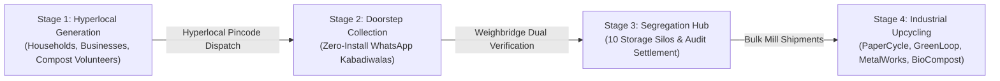

<div align="center">

# 🌿 circular. (Terra)
### *Your waste. Better placed.*

**An end-to-end circular economy platform connecting households, commercial businesses, and local scrap collectors (*kabadiwalas*) to automated segregation hubs and certified recycling plants.**

[](https://nodejs.org/)
[](LICENSE)
[](https://github.com/WhiskeySockets/Baileys)
[](https://groq.com/)
[](https://tailwindcss.com/)
[](https://sqlite.org/)

<br/>

[Live Demo Portals](#-live-demo-portals-for-judges) •
[4-Stage Circular Pipeline](#-the-4-stage-circular-pipeline) •
[Key Innovations](#-key-innovations) •
[System Architecture](#-system-architecture) •
[WhatsApp Collector Network](#-zero-app-whatsapp-collector-network) •
[Getting Started](#-getting-started) •
[Security & Privacy](#-security--privacy)

</div>

---

## 🌐 Live Demo Portals (For Judges)

| Portal | Role & Purpose | Live Access |
| :--- | :--- | :--- |
| 📱 **Customer Web App** | Household scrap booking, Terra AI camera scanner, wallet, dual households | [**Launch Customer App**](https://chess-richards-hugh-engineer.trycloudflare.com/) |
| 🎛️ **Admin Master Dashboard** | Live pickups, collectors dispatch, volunteer hub manager, weight audits | [**Open Admin Panel**](https://chess-richards-hugh-engineer.trycloudflare.com/admin) *(Key: `circular-admin-2024`)* |
| 🏭 **Segregation Hub Floor** | Weighbridge floor terminal, dual-scale audit logs, 10 material silos | [**Open Hub Terminal**](https://chess-richards-hugh-engineer.trycloudflare.com/hub) |
| 💬 **WhatsApp Field Bot** | Native Baileys WebSocket bot for collectors & citizens | **`+91 76578 64774`** |
| 📞 **Dedicated Support Helpline**| 24/7 Citizen & Collector telephone + WhatsApp helpline | **`+91 78147 76666`** |

---

## ♻️ The 4-Stage Circular Pipeline

Unlike traditional garbage collection apps that stop at pickup booking, **circular.** bridges the entire waste journey from citizen doorsteps to industrial recycling furnaces:



| Stage | Name | Description & Key Tech |
| :---: | :--- | :--- |
| **Stage 1** | **Hyperlocal Generation** | Households book doorstep dry scrap pickups or drop off kitchen bio-waste at community volunteer compost hubs. Businesses schedule bulk carton & metal disposal. |
| **Stage 2** | **Doorstep Collection** | Zero-install WhatsApp bot automatically dispatches the nearest local collector matching the customer's **6-digit Indian PIN code**. Verification is completed via QR scan and 4-digit PIN. |
| **Stage 3** | **Segregation & Hub Floor** | Collectors bring bulk sacks to the hub weighbridge. The terminal reconciles **Weight 1 (Doorstep)** against **Weight 2 (Floor Scale)** to detect fraud before settling payouts into 10 dedicated silos. |
| **Stage 4** | **Industrial Upcycling** | As storage silos approach capacity, the system triggers automated bulk dispatch manifests to certified recyclers (*PaperCycle Mills, GreenLoop Plastics, MetalWorks, BioCompost Plant*). |

---

## 🌟 Key Innovations

### 1. ⚖️ Dual-Scale Anti-Fraud Weighbridge System
To prevent scrap under-reporting and adulteration:
* **Weight 1 (Collector Doorstep Declaration)** is compared against **Weight 2 (Hub Weighbridge Scale)**.
* If discrepancy exceeds **10%**, an **`Audit Alert (+Gap %)`** is automatically triggered and flagged for admin triaging.
* Admins can adjust weighings, approve verified payouts, or recalibrate with 1 click.

### 2. 🌱 Biodegradable Community Volunteer Network
* Empowers local residential champions, schools, and garden clubs to register as **Verified Community Drop-off Stations**.
* Diverts wet kitchen waste and compostable matter away from landfills directly into **Hub Silo #8 (`Organic wet waste`)** for delivery to industrial biogas and composting plants.
* Managed directly from the Admin Panel with WhatsApp contact links, pincode filters, and status toggles.

### 3. 🤖 Multimodal AI & Field Voice Accessibility
* **Terra AI Vision:** Upload or snap a picture of any item (e-waste, cardboard, mixed plastic). The AI instantly identifies material composition, gives segregation instructions, and calculates estimated scrap market payout.
* **WhatsApp Voice Note Engine:** Integrated with **Groq Whisper** speech-to-text. Field workers who cannot read or write can send voice notes in **Hindi / Hinglish / English**, and the bot automatically responds via native WhatsApp audio notes.

### 4. 👨‍👩‍👧 Dual Household Architecture
* Citizens never lose their personal household identity when collaborating with flatmates or family members.
* 1-click switcher between **🏠 My Home** and **👨‍👩‍👧 Family Household** with shared access to active doorstep collection PINs so anyone at home can verify pickups.

### 5. ⚡ Hyperlocal Pincode Dispatch Matching
* Scrap orders are strictly routed to Kabadiwalas operating within the **same 6-digit postal pincode** as the customer.
* Expanded 15-minute presentation buffer ensures judges and testing partners have seamless demo response windows.

---

## 📲 Zero-App WhatsApp Collector Network

The collector experience requires **zero app installation**:

```text
1. Customer books pickup ➔ Bot alerts nearest collector in that pincode on WhatsApp:
   "🔔 NAYA PICKUP ALERT! #REQ-4692 • 15 kg Dry Recyclables • Model Town"

2. Collector arrives at doorstep ➔ Customer taps [Show QR & PIN] on their phone.

3. Collector points camera at QR ➔ Auto-opens verified chat:
   "VERIFY REQ-4692 6348"

4. Collector hits Send:
   ➔ Pickup status updates to COMPLETED across all screens instantly
   ➔ Customer receives "+50 Green Points" and doorstep cash payout
   ➔ Bot prompts collector for gross weigh-in confirmation

5. Collector unloads at Segregation Hub:
   ➔ Floor staff records Hub Scale Weight 2
   ➔ Dual-scale audit verifies accuracy & releases instant payout!
```

---

## 🛠️ Complete Tech Stack

| Component | Technology | Description |
| :--- | :--- | :--- |
| **Frontend** | Vanilla JS (ES6+), HTML5, Tailwind CSS | Ultralight mobile-first Single Page Application running at 60 FPS |
| **Icons & UI** | Phosphor Icons, Tailwind Forms | Clean, accessible vector iconography |
| **QR Engine** | Client-Side `qrcode.js` | Offline 0ms instant QR generation |
| **Backend** | Node.js, Express.js | High-throughput REST API with event streams & real-time WebSockets |
| **Database** | SQLite via `sql.js` | Fast embedded relational database with atomic file persistence |
| **Messaging Engine**| `@whiskeysockets/baileys` | Native headless WhatsApp WebSockets (direct protocol, zero Twilio fees) |
| **AI Processing** | Groq API (Whisper Llama 3) | Sub-second audio transcription & multilingual conversational intent |
| **Tunnel / Edge** | Cloudflare Quick & Named Tunnels | Instant global SSL tunneling to local hardware |

---

## 🚀 Getting Started

### Prerequisites
* **Node.js** (v18.0.0 or higher)
* **npm** (v8.0.0 or higher)

### 1. Clone the Repository
```bash
git clone https://github.com/ParvIsGood/Terra.git
cd Terra
```

### 2. Install Backend Dependencies
```bash
cd backend
npm install
```

### 3. Environment Configuration
Create or inspect your `backend/.env` file:
```env
PORT=3001
GROQ_API_KEY=your_groq_api_key_here
```

### 4. Start the Application
```bash
# Starts the server and direct WhatsApp WebSocket engine
node server.js
```

### 5. Connect WhatsApp Bot
1. Open your terminal output.
2. If connecting for the first time, scan the QR code printed in the terminal (or displayed on `/admin.html`) using WhatsApp $\rightarrow$ **Linked Devices** $\rightarrow$ **Link a Device**.
3. Credentials are saved locally in `backend/.baileys_auth` and stay authenticated permanently.

### 6. Access Local Portals
* **Customer Mobile Web App:** `http://localhost:3001`
* **Admin Master Panel:** `http://localhost:3001/admin.html`
* **Segregation Hub Floor Station:** `http://localhost:3001/hub.html`
* **System Health Check:** `http://localhost:3001/api/health`

---

## 🔒 Security & Privacy

* **Zero WhatsApp Token Leaks:** Baileys session states and private crypto keys are stored in `.baileys_auth` and excluded via `.gitignore`.
* **Randomized 4-Digit Doorstep PINs:** Every pickup generates a unique challenge PIN to eliminate spoofed scans.
* **Pincode Privacy & UPI Sanitization:** Payment QR codes and support dialogues are sanitized to prevent personal ID exposure.
* **Collector Role Guards:** Unauthorized phone numbers cannot verify doorstep orders or trigger payout disbursements.

---

## 📄 License

Distributed under the **MIT License**. See `LICENSE` for more information.

<div align="center">
  <sub>Built with 💚 by <b>Terra</b> — Empowering Kabadiwalas, Citizens & Sustainable Cities.</sub>
</div>
